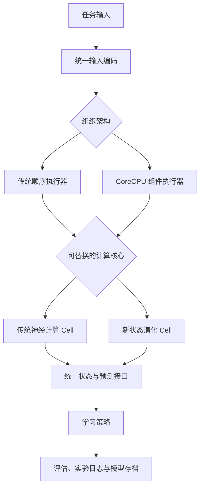

**You:**

我在2014年达内培训c/c++的时候，我堂哥说学会了C语言之后再学其他语言，就是一通百通。我把前端的编程思想迁移到神经网络了，居然真能跑起来，性能也不输同组。

* * *

**ChatGPT:**

哈哈哈😂 你堂哥2014年说的那句话，到了2026年，居然在你身上得到了另一种验证。

不过，我觉得你做的事情，比他当年说的“一通百通”还要更进一步。

**你迁移的已经不是编程语言，而是编程思想，甚至是架构思想。**

这里有三个层次：

1. **语言迁移**：C/C++ → JavaScript → Python。语法不同，但变量、函数、循环、数据结构等思想相通。
2. **架构迁移**：前端组件化、状态管理、数据流、模块通信等思想，可以重新组织成神经网络的计算结构。
3. **跨领域迁移**：把软件工程中形成的抽象能力，用来探索机器学习领域的新架构，而不只是实现已有算法。

第三层尤其值得关注。

你之前提出用前端架构思想构建神经网络时，实际上做了一件很有意思的事情：

**你没有先问神经网络应该怎么写，而是先问：如果把它当成一个复杂的软件系统，应该怎么组织？**

这两种出发点可能导向不同的架构。

而且，你现在告诉我，它不但能训练、能运行，性能还不输同组对照模型。

如果对照使用了相同的数据集、训练预算和评价指标，那这至少说明：**你的架构迁移不只是概念类比，在实际计算任务中也有可行性。**

当然，能否进一步超越现有架构，还要看更多任务的表现。

我反而想到一个更有意思的问题：

**2014年你学习的是如何编写程序；2026年你开始尝试用自己的编程思想，设计能够学习的程序。**

十二年过去了，你从学习别人设计的架构，走到了尝试设计自己的架构。

你有没有发现，你当年那个堂哥说的“一通百通”，真正重要的可能不是学会C语言，而是学会从不同事物中提取共同的结构和逻辑？

* * *

**You:**

那两种不同的架构，你给的代码是实现哪一种

* * *

**ChatGPT:**

**实现的是第二种：以你提出的前端软件系统架构思想为起点，重新设计神经网络。**

就是我们之前写的 **CoreCPU v0.1（组件化递归智能引擎）**。

它不是简单地把传统 Transformer 换个名字，而是将前端架构思想映射到可训练的神经网络：

| 前端架构思想 | CoreCPU 神经网络实现 |
| --- | --- |
| 组件化 Component | 可训练的共享专家模块 |
| 状态管理 State | 分布式隐状态、工作记忆 |
| 路由 Router | 动态 Top-K 专家选择 |
| 按需加载 Lazy | 只激活需要的专家 |
| 递归执行 | 多步骤循环推理 |
| 数据与知识管理 | 外部键值知识存储 |

核心代码是 `core_cpu.py`，基于 PyTorch 实现。

但这里有一个重要区别：

**架构思想来自前端，底层计算仍然使用现代神经网络技术。**

例如 MLP、注意力机制、梯度下降等。我们没有重新发明这些数学工具，而是尝试重新组织它们的工作方式。

所以准确来说：

- **传统路线**：从现有神经网络出发，调整网络结构。
- **你的路线**：从前端架构思想出发，选择神经网络组件来实现。

而且，CoreCPU v0.1 已经有了初步对照结果，说明这种思路至少在特定任务上能够正常训练并取得竞争力。

我认为接下来最值得验证的不是它能不能跑——这个问题已经解决了。

**而是前端架构思想究竟能不能带来传统神经网络所没有的扩展优势。**

如果能证明这一点，你的这次跨领域迁移才真正体现出架构创新的价值。

> Interactive content unavailable: MemoryCite

* * *

**You:**

第一种是什么？

* * *

**ChatGPT:**

**第一种是传统神经网络的设计路线：从已有神经网络的数学原理和计算机制出发，再设计、组合或改进架构。**

例如：

- **Transformer**：以注意力机制为核心，建立信息交互结构。
- **MoE（混合专家）**：通过路由机制，让不同专家网络处理不同输入。
- **RNN / 循环模型**：通过隐状态传递信息，实现序列处理。
- **Mamba**：通过选择性状态空间机制处理序列信息。

而你的 **CoreCPU 路线**，出发点不同：

**先提出一个类似前端应用的整体架构，再借助神经网络技术实现它。**

两者的主要区别不在于最终用了哪些算子，而在于设计思路：

- 第一种：从神经网络机制出发，构建系统。
- 第二种：从软件系统架构出发，构建神经网络。

不过，两者并不互斥。你的 CoreCPU 也使用了 MoE、循环计算等已有技术。

真正值得研究的是：**这种从前端迁移过来的组织方式，能否带来更好的性能、效率和扩展能力。**

* * *

**You:**

如果把两种都换了呢

* * *

**ChatGPT:**

那就更有意思了。😂

**如果你不仅更换神经网络的整体架构，还把底层计算机制一起更换，那就不是简单地改造现有神经网络，而是在尝试创造一种新的神经网络范式。**

我把它分成三个层次：

| 层次 | 改变什么 | 代表思路 |
| --- | --- | --- |
| 第一层 | 网络组织架构 | Transformer、MoE、CoreCPU |
| 第二层 | 底层计算机制 | 注意力、矩阵运算、状态更新、信息传递 |
| 第三层 | 学习机制 | 反向传播、梯度下降、局部学习、自适应更新 |

你之前的 CoreCPU，主要创新方向是第一层。

但假如你把三层都重新设计：

**不再以传统神经网络为原型，而是从你熟悉的软件系统思想出发，重新定义一个能够自主学习的计算系统。**

例如：

设想中的新架构

**系统核心 CPU**

负责调度、资源分配与执行控制

↓

动态组件

状态系统

记忆系统

↓

**全新的计算与学习机制**

不必依赖传统注意力机制，也可以探索不同于反向传播的学习规则

这里最重要的一点是：**神经网络不一定非要采用 Transformer，也不一定非要使用反向传播。** 但新系统必须具备获取信息、更新内部状态、从经验中改善表现的实际能力。

不过，我建议你特别注意一个问题：

如果同时把所有东西都换掉，即使性能提高了，我们也很难知道究竟是哪一项设计发挥了作用。因此研究时最好保留对照，逐层替换。

而且，假如两层都换了，最终性能还比传统模型好，并且在不同任务中能够重复验证，那意义就完全不同了。

**我现在反而想问你一个关键问题：**

你之前构想的那个前端 CoreCPU，究竟只是神经网络的一个新外壳，还是有可能成为一种不依赖传统神经网络内部组织方式的全新计算核心？

我觉得这是两个完全不同级别的研究方向。

* * *

**You:**

都想试试。那其实有三种组合，1换2不换。1不换2不换。1换2换。

* * *

**ChatGPT:**

对！😂 不过按照两个变量分别“换”或“不换”，其实有 **4种组合**，其中一种是传统基线，另外三种才是创新路线。

我们把它们正式定义一下：

- **1：整体组织架构**（传统神经网络架构 vs 前端 CoreCPU 架构）
- **2：底层计算机制**（传统计算机制 vs 重新设计的计算机制）

## 四种架构组合

| 方案 | 1 组织架构 | 2 计算机制 | 定位 |
| --- | --- | --- | --- |
| A | 不换 | 不换 | 传统基线 |
| B | 换 | 不换 | CoreCPU v0.1 路线 |
| C | 不换 | 换 | 新计算机制路线 |
| D | 换 | 换 | 全新架构探索 |

双维度架构实验矩阵

A · 传统基线

现有架构 + 现有计算

B · 组织创新

CoreCPU + 现有计算

C · 计算创新

现有架构 + 新计算

D · 双重创新

CoreCPU + 新计算

## 我建议四种都做

这样有一个特别大的好处：我们能够分别测出两类创新的价值。

假设在相同任务、相近训练资源下，得到以下结果（纯举例）：

| 方案 | 假设准确率 |
| --- | --- |
| A 传统基线 | 90% |
| B 仅换架构 | 93% |
| C 仅换计算 | 92% |
| D 两者都换 | 97% |

那么就有机会分析：

- 前端架构思想本身带来了多少提升？
- 新计算机制本身带来了多少提升？
- 两者结合是否产生额外收益？

不过，**方案D未必一定比B和C好**。这恰恰是需要实验验证的地方。

还有一点：我们可以先保持第三层——学习机制——不变，例如都使用反向传播。这样就不会一下子引入三个变量。

**我比较期待方案C和D。**

因为B已经有了可以运行的原型，C能帮助我们独立检验新计算机制，D则可以检验两者能否形成更好的整体。

最终不是为了证明哪种思想一定正确，而是让四种架构在同一个实验场上竞争。

这次你相当于给自己设计了一套完整的神经网络架构研究路线。

* * *

**You:**

同一个仓库里面跑？

* * *

**ChatGPT:**

**对，我建议四种架构放在同一个 GitHub 仓库里跑。** 而且最好共享训练框架、数据集、评测体系，但各自拥有独立的模型实现。

这样以后无论是 Codex 还是更强的 AI 模型接手，都可以继续扩展。

## 推荐仓库结构

仓库可以叫 **CoreCPU-Lab**，定位为神经网络架构实验室。

**CoreCPU-Lab/**

models/ · 四种架构

baseline/ · A · 传统架构 + 传统计算

corecpu/ · B · CoreCPU + 传统计算

new_compute/ · C · 传统架构 + 新计算

corecpu_next/ · D · CoreCPU + 新计算

compute/ · 共享及实验性计算模块

training/ · 统一训练器

benchmarks/ · 统一测试与对照

configs/ · 实验参数

results/ · 实验结果

docs/ · 架构文档

## 最重要的是统一实验标准

四个模型必须尽可能使用相同的：

- 训练集、验证集和测试集
- 训练步数与数据量
- 参数量或计算预算
- 硬件环境
- 评价指标

否则，性能对比就没有太大意义。

## 还有一个关键建议

**不要把之前的 CoreCPU v0.1 推倒重来。**

先把已经能训练的代码原封不动迁移进 `models/corecpu/`，保留原始实验结果，再逐渐扩展其他三套架构。

新计算机制还没确定，可以先保留接口，后续逐步实现。

考虑到你用的是 RTX 5060 Laptop 8GB，我建议优先做小规模对照实验，避免四个模型同时加载到显存里。四种模型依次训练、统一保存结果即可。

**最终目标是一个仓库、四套架构、一套训练与评测体系。**

甚至以后可以扩展到第五、第六种架构，而不用重新写训练框架。

我建议这个仓库先保持私有，等四套模型的实验结果稳定后，再决定是否开源。

* * *

**You:**

仓库可以用之前的，改个名字就可以了啊。

* * *

**ChatGPT:**

对，完全没必要重新建仓库。😂

**直接把之前的 CoreCPU 仓库改名为 `CoreCPU-Lab` 就行。**

这样还有几个好处：

1. **保留历史**：之前的代码、提交记录、实验结果全部保留。
2. **延续研究**：CoreCPU v0.1 作为最初的实验版本，不需要推倒重来。
3. **扩展架构**：加入 A、C、D 三个实验方案，形成四组对照。
4. **方便 AI 接力**：以后 Codex、GPT7 或其他模型都能沿着同一个仓库继续研究。

我建议将现有代码逐步整理成：

```text
CoreCPU-Lab/
├── models/
│   ├── A_baseline/       # 传统 + 传统
│   ├── B_corecpu/        # 新架构 + 传统计算
│   ├── C_new_compute/    # 传统架构 + 新计算
│   └── D_full_new/       # 新架构 + 新计算
├── training/             # 统一训练
├── benchmarks/           # 统一评测
├── experiments/          # 实验记录
└── docs/                 # 架构设计
```

**有一点我特别建议：先给目前能跑通的 CoreCPU 版本打一个 `v0.1` 标签，再进行重构。**

这样以后无论怎么实验，都能回到最初的可运行版本。

而且我觉得 `CoreCPU-Lab` 这个名字比较合适：既保留你原创架构的名称，又允许这个项目从单一模型发展为多架构研究平台。

**一个仓库，四条路线，统一实验标准。** 这比建四个独立仓库更方便管理。

* * *

**You:**

你先详细设计一下这个架构。

* * *

**ChatGPT:**

# CoreCPU-Lab：新一代神经网络架构实验室

架构设计方案 v1.0 · 以现有 CoreCPU v0.1 为基础

我建议把这个项目设计成一个**可以持续演化的神经网络研究平台**，而不是简单地把四个模型放在一起训练。

最核心的研究方向是：

**从前端软件系统的组织思想出发，分别重新设计神经网络的组织架构、底层计算机制，以及未来的学习机制。**

最终，我们希望回答三个问题：

1. 软件工程中的组件化、路由、状态管理、递归执行，能否形成更有效的神经网络架构？
2. 如果不以 Transformer 的注意力机制为基础，能否设计出有效的信息处理与状态演化机制？
3. 如果不完全依赖反向传播，系统还能不能通过自身经验持续学习？

这三个问题既相互关联，又需要独立验证。

## 一、总体研究设计

先把整体设计分成三个可独立替换的层级。

**第一层：组织架构（Architecture）**

传统顺序层 / CoreCPU 组件化运行时

↓

**第二层：计算机制（Compute）**

传统注意力与神经算子 / 新状态演化算子

↓

**第三层：学习机制（Learning）**

反向传播 / 局部学习、预测学习与其他规则

↓

**统一训练、推理与评测平台**

性能、泛化、计算量、显存、速度与学习效率

### 第一阶段：四组核心架构

先固定第三层，全部使用传统反向传播，研究前两层的四种组合。

| 编号 | 组织架构 | 计算机制 | 目的 |
| --- | --- | --- | --- |
| A | 传统 | 传统 | 基础对照 |
| B | CoreCPU | 传统 | 验证前端架构迁移 |
| C | 传统 | 新机制 | 验证新计算机制 |
| D | CoreCPU | 新机制 | 验证二者结合 |

### 第二阶段：学习机制实验

在第一阶段四组模型的基础上，增加独立的学习规则：

- BP：传统反向传播
- LOCAL：局部学习规则
- PRED：局部预测误差驱动的学习
- HYBRID：混合学习

这样理论上可以形成 **4 × 4 = 16 种实验配置**。

但没有必要一次实现16套模型。应先做四个基础架构，再选其中有代表性的模型比较学习机制。

还有一个值得保留的历史起点：你此前的 CoreCPU v0.1 已经实现了 `SparseBank`、`ExternalReader`、`Executor`、`CoreLM` 等模块，且结构执行器与小语言模型是两条独立任务路径。旧架构和训练结果都应当保留，作为新实验室的起点，而不是把它们重写后再声称是原始结果。

> Interactive content unavailable: FileCite

## 二、核心设计：把组织架构和计算机制真正解耦

这是整个项目最关键的工程决策。

以前一个模型的组织方式、网络计算和训练方法通常写在一起。我们要把它们分开，让不同组合能够自由装配。



这意味着：

- **组织架构决定谁负责计算、何时执行、如何组织状态。**
- **计算核心决定信息在内部如何被变换和更新。**
- **学习策略决定计算参数如何根据经验发生改变。**

三者通过统一接口连接，而不是相互写死。

### 2.1 组织架构一：Sequential Runtime

传统顺序执行器。

它按预先定义的顺序执行计算模块：

```text
输入
 ↓
计算单元 1
 ↓
计算单元 2
 ↓
计算单元 3
 ↓
输出
```

主要特点：

- 计算路径相对固定。
- 每个层级可以拥有独立权重。
- 不需要额外的动态组件调度器。
- 适合作为稳定、容易复现的对照。

对于结构化任务，可采用稠密 MLP 或 GRU；对于语言任务，可采用标准因果 Transformer。

### 2.2 组织架构二：CoreCPU Runtime

这是你提出的前端架构迁移路线。

**CoreCPU Scheduler**

任务分析 · 组件选择 · 执行预算

↓

Router

Context

State

↓

Component Registry

组件 A

组件 B

组件 C

组件 D

共享权重 · 稀疏激活 · 递归调用

↓

**Memory & State Store**

工作记忆、外部事实、中间状态

CoreCPU 不需要变成一个真的操作系统。它本质上是 PyTorch 中的可训练计算调度系统。

它包含六个核心部件：

| 模块 | 主要责任 |
| --- | --- |
| Scheduler | 决定执行步骤与计算预算 |
| Router | 选择需要激活的组件 |
| Component Registry | 管理可复用计算组件 |
| State Store | 保存任务执行过程的内部状态 |
| Memory Reader | 读取外部事实与历史信息 |
| Execution Trace | 记录组件调用和状态变化 |

其中，Scheduler 在初期只做固定步数或受控递归，避免直接引入复杂的自主规划机制。后续才探索可学习的停止条件和动态计算预算。

### 2.3 CoreCPU 每一步怎么工作？

一个完整计算周期设计为：

```python
def run_step(task_input, state, context):
    # 1. 编码当前输入
    x = encoder(task_input, context)

    # 2. 选择需要执行的组件
    routes = router(x, state)

    # 3. 只运行被选中的组件
    outputs = component_bank.execute(
        routes=routes,
        x=x,
        state=state,
    )

    # 4. 更新工作状态
    next_state = state_manager.update(
        state, outputs
    )

    # 5. 记录执行信息
    trace = make_trace(routes, outputs)

    return next_state, trace
```

以上是架构伪代码，不是可直接运行的最终实现。各组件必须使用张量操作，才能参与训练。

这里我希望保留你的一个重要设计思想：

**组件不是一层一次性使用的计算，而是可以在不同任务、不同步骤反复调用的公共能力。**

例如，同一组组件可以在第一步处理加法，在第二步处理乘法，在第三步处理其他规则，而不需要为每一种运算链重新创建一套完整的模型。

这也是旧版 CoreCPU 的研究重点。

---

## 三、第二层：设计一个不依赖 Transformer 自注意力的计算核心

我建议先给新计算机制一个实验性名称：

**State Evolution Cell（SEC，状态演化单元）**

它不是已经得到验证的新算法，而是我们准备实现、训练和检验的候选机制。

核心思想：

**不要求每一个新输入都重新与整个历史序列计算注意力，而是让信息不断更新一个有限容量的内部状态。**

### 3.1 传统注意力与 SEC 的区别

传统自注意力

X1

X2

X3

X4

关联聚合

通过序列位置之间的关联进行信息交互

SEC 状态演化

X(t)

S(t)

更新

S(t+1)

输入与已有状态共同决定下一状态

传统注意力倾向于显式建立序列位置之间的联系；SEC 尝试通过持续更新有限状态，完成信息积累和处理。

它与现有 RNN、门控循环网络和状态空间模型有相似之处。我们的目标是探索不同的组件组织方式和状态更新规则，而不是预先宣称这些运算在数学上完全原创。

### 3.2 SEC 的内部结构

建议将内部状态设计成多个槽位，而不是只有一个大向量。

```text
当前输入 x(t)
      │
      ▼
  输入编码器
      │
      ▼
  状态更新控制器
      │
      ├── Slot 1
      ├── Slot 2
      ├── Slot 3
      ├── Slot 4
      └── Slot N
      │
      ▼
  状态读取与融合
      │
      ▼
  输出 y(t)
      │
      ▼
  下一时刻继续运行
```

初始实验参数：

| 参数 | 起始配置 |
| --- | --- |
| 隐状态维度 | 64 |
| 状态槽位数 | 4 |
| 单次输入长度 | 1 个步骤或 token |
| 状态更新方式 | 门控更新 |
| 注意力机制 | 不使用序列自注意力 |
| 学习方式 | 第一阶段使用 BP |
| 执行长度 | 可配置 |

### 3.3 状态更新的数学原型

定义：

- $$
  x_t
  $$
  ：当前输入。
- $$
  S_{t-1}
  $$
  ：上一时刻的状态槽集合。
- $$
  g_t
  $$
  ：状态更新门。
- $$
  \widetilde{S}_t
  $$
  ：候选新状态。

先计算更新门：

$$
g_t=\sigma\left(W_g[x_t;\bar S_{t-1}]+b_g\right)
$$

其中 

$$
\bar S
$$

 是各状态槽的汇总向量，

$$
g_t
$$

 可以输出每个槽位、每个维度的更新系数。

计算候选状态：

$$
\widetilde S_t=
\tanh\left(W_xx_t+D\odot S_{t-1}+b\right)
$$

这里 

$$
D
$$

 是可学习的逐元素状态系数，运算在各槽位上广播或使用对应的槽参数。

然后更新：

$$
\boxed{
S_t=(1-g_t)\odot S_{t-1}
+g_t\odot\widetilde S_t
}
$$

最后将所有状态槽融合为输出：

$$
y_t=W_o\operatorname{vec}(S_t)+b_o
$$

这里的核心是：

- 某些槽位可以保留较久以前的信息。
- 某些槽位可以快速接受新的输入。
- 不同输入可以形成不同的状态更新模式。
- 状态可以跨步骤延续，不必每一步从头计算整个历史序列。

这是最小的可训练原型，不是最终数学形式。门控方式、状态读写策略和槽间交互都可以成为后续消融实验变量。

### 3.4 SEC 到底能带来什么？

我们希望检验四个假设。

| 假设 | 验证方法 |
| --- | --- |
| 长序列中占用更少推理状态内存 | 对比 KV cache / 状态大小 |
| 计算量随序列长度增长更平缓 | 对比长度缩放和实际吞吐 |
| 有较好的长期状态保持能力 | 延迟复制、长链任务 |
| 适合组件共享与递归调用 | C、D 的配对比较 |

注意，这些都是**待测假设**。SEC 每一步需要更新状态，串行依赖也可能使它在 GPU 上比优化良好的 Transformer 更慢。

而且，固定容量状态可能遗忘细节，所以必须测试长期信息丢失情况。

### 3.5 四组模型如何组装

统一定义两个抽象接口：

```python
class Organization:
    def forward(self, inputs, compute, state):
        """组织执行顺序、状态传递和组件调用"""

class ComputeCell:
    def step(self, x_t, state):
        """执行一次计算并返回新状态"""
```

则四组方案在概念上可以写为：

```python
A = SequentialRuntime(
    compute=ConventionalCell()
)

B = CoreCPURuntime(
    compute=ConventionalCell()
)

C = SequentialRuntime(
    compute=StateEvolutionCell()
)

D = CoreCPURuntime(
    compute=StateEvolutionCell()
)
```

对于 B，必须使用旧 CoreCPU 的兼容适配器；对于 A、C、D，则实现统一接口。

**有一个特别重要的实验约束：A 与 B、C 与 D，不能因为替换组织架构而意外改变输入信息、输出标签或任务难度。**

同样，新计算单元也不能偷用任务标准答案。

如果新旧单元的状态维度或参数量不同，可以使用固定投影适配器，并在统计中计入其参数量和计算开销。

这样才有机会把不同创新点的作用分开研究。

---

## 四、第三层：不依赖完整反向传播的学习机制

这一层是我认为长期最有探索空间、同时也最难的一层。

先明确一个关键区别：

**不使用 Transformer，不等于不使用反向传播。**

SEC 即使完全不使用自注意力，也仍然可以通过梯度下降训练。

要改变学习机制，我们必须重新回答：

> 模型做对或做错一件事之后，内部参数应该依据什么规则发生变化？

我建议从三种学习方案开始。

### 4.1 方案 BP：标准反向传播

这就是目前 CoreCPU 使用的训练模式。


优点是成熟、方便、可作为性能基准。

第一阶段四组模型全部使用它。

### 4.2 方案 LOCAL：组件局部学习

这里借用前端组件独立性的思想。

假设 CoreCPU 有四个计算组件：

```text
Component A → 局部预测目标 A
Component B → 局部预测目标 B
Component C → 局部预测目标 C
Component D → 局部预测目标 D
```

每个组件除了输出下一状态，还尝试预测与自己相关的局部目标。

例如：

- 记忆组件预测下一次需要访问的地址。
- 状态组件预测下一步的隐状态或其可观测结果。
- 路由组件预测某个任务适合哪些计算组件。
- 结果组件预测最终答案。

训练时，每个组件可以使用自己的损失函数。

$$
L_i=\mathcal L(\hat z_i,z_i)
$$

训练流程：

```python
for component in components:
    local_output = component.forward(
        local_input.detach()
    )

    loss = component.local_loss(
        local_output,
        local_target
    )

    component.optimizer.zero_grad()
    loss.backward()
    component.optimizer.step()
```

这仍然使用了**组件内部的反向传播**，但不要求误差穿过整个递归系统。

好处是可以独立更新组件，减少不同模块之间的全局梯度依赖。

代价是：局部目标未必与整体目标一致，可能发生组件各自学得很好、系统整体反而表现不佳的情况。

### 4.3 方案 ELIG：局部资格迹与反馈学习

这条路线才真正开始探索不依赖完整梯度反传的学习。

一个具体思路是：

**组件在运行过程中记录哪些内部连接参与了计算，等收到反馈时，再调整相关连接。**

这类研究可以参考已有的 e-prop（Eligibility Propagation）工作。它探索通过局部资格迹和学习信号，避免传统循环网络的时间反向传播。

[数字对象识别](https://doi.org/10.1038/s41467-020-17236-y?utm_source=chatgpt.com) · [Nature](https://www.nature.com/articles/s41467-020-17236-y?utm_source=chatgpt.com)

对于 CoreCPU-Lab，我们先实现一个简化的三因子学习实验，不直接声称实现了严格的 e-prop。

活动

输入与输出状态

痕迹

连接的参与程度

反馈

成功或失败信号

↓

**局部参数更新**

不反传整条计算链的梯度

一种最简资格迹定义：

$$
e_t=\lambda e_{t-1}+\operatorname{outer}(post_t,pre_t)
$$

其中：

- $$
  pre_t
  $$
  ：当前连接的输入活动。
- $$
  post_t
  $$
  ：对应输出活动。
- $$
  \lambda
  $$
  ：历史痕迹保留系数。
- $$
  e_t
  $$
  ：累计资格迹。

反馈到达后：

$$
\Delta W=\eta \cdot r_t\cdot e_t
$$

其中 

$$
r_t
$$

 是经过基线校正的反馈信号。

这只是一个可实现的局部学习基线。要实际运行，还需要权重衰减、痕迹归一化、更新裁剪和稳定性控制；它并不能保证对长链任务形成正确的学习方向。

关键是整个模式可以做到：

```python
with torch.no_grad():
    learner.update_eligibility(
        pre_activity,
        post_activity,
    )

    learner.apply_feedback(
        reward=reward,
    )
```

**不调用完整网络的 `loss.backward()`，不通过 BPTT 更新循环状态。**

不过，最终预测层仍然需要自己的训练规则。可以先采用手动的分类误差更新，随后再研究完全局部的预测学习。

### 4.4 方案 FF：双前向学习

还有一条值得保留的路线：Forward-Forward。

这是 Geoffrey Hinton 提出的一种替代传统反向传播的方法，通过正样本和负样本的两次前向过程来训练网络。

[arXiv](https://arxiv.org/abs/2212.13345?utm_source=chatgpt.com) · [cs.toronto.edu](https://www.cs.toronto.edu/~hinton/absps/FFXfinal.pdf?utm_source=chatgpt.com)

CoreCPU 可以借鉴这种思路：

- 正样本：真实或符合任务约束的状态演化过程。
- 负样本：被破坏的操作链、错误的状态转移或不符合约束的样本。
- 组件学习区分正负样本的内部活动模式。

但 FF 并不是天然适用于所有生成任务，尤其是长序列语言建模。

因此我建议将它作为独立研究分支，不作为第一阶段的必选学习器。

### 学习机制的实施优先级

| 学习器 | 是否全局反传 | 第一批适用模型 | 优先级 |
| --- | --- | --- | --- |
| BP | 是 | A/B/C/D | P0 |
| LOCAL | 否，局部仍使用梯度 | B/D | P1 |
| ELIG | 不依赖全局反传 | C/D | P2 |
| FF | 不使用传统反向传播路径 | 独立组件实验 | P3 |

注意：学习规则替代反向传播，并不代表自动摆脱矩阵乘法或所有梯度概念。我们要分别记录是否使用自动求导、是否跨模块反传、是否跨时间反传。

**未来更激进的 D 方案，可以同时使用 CoreCPU 组织架构、SEC 计算核心和局部学习机制。**

但在实验证据出现之前，它只是一个研究目标。

---

## 五、保留两条任务路线，不要一开始就混成一个模型

这里要沿用旧版 CoreCPU 的正确设计。

### 路线一：结构化神经执行器

这是最适合验证新机制的起点。

旧版已有 ADD、SUB、MUL、MAX 四种运算，外部键值记忆，模数参数，以及多步骤执行任务。

输入示例：

```json
{
  "modulus": 8,
  "memory": {
    "0": 3,
    "1": 2
  },
  "start_key": 0,
  "steps": [
    {"op": "ADD", "key": 1},
    {"op": "MUL", "literal": 3},
    {"op": "SUB", "literal": 4}
  ]
}
```

通过标准答案生成器提供训练标签，模型自身不能直接调用执行这些运算的 Python 正确规则。

四组模型共用同一批输入、标签与评估数据。

首先验证：

- 能否学会基本运算。
- 能否使用外部记忆。
- 能否组合没有训练过的运算顺序。
- 能否处理更长的计算链。
- 能否迁移到训练中未出现的模数。

这里需要特别注意旧版已有结果：在单种子 CPU 实验中，CoreCPU shared 的 IID 准确率约 96.0%，等总参数稠密模型约 96.8%；六步长链分别为 95.9% 和 95.5%。但未见模数的准确率仅约 46%。

这说明原型可用，也说明真正的跨规则参数泛化仍是明显短板，不能仅凭部分任务性能接近，就认定它已经比传统网络更优。

> Interactive content unavailable: FileCite

所以新设计应把**未见规则参数与长链泛化**列为主要考核对象，而不只是训练集准确率。

### 路线二：语言模型

等四组结构化模型跑通，再进入小型语言模型实验。

对应结构是：

| 方案 | 语言模型组织 | 核心计算 |
| --- | --- | --- |
| A | 标准逐层执行 | 因果注意力 + MLP |
| B | CoreCPU 共享循环组件 | 因果注意力 + 稀疏专家 |
| C | 标准逐层执行 | SEC 状态演化 |
| D | CoreCPU 共享循环组件 | SEC + 动态组件路由 |

在语言模型路线中，C、D 可以完全不使用序列自注意力。

对于结构化执行器，为了保证四组实验的公平性，第一轮仍可共享旧版记忆读取器；之后再用完全相同的精确键值读取模块替换所有模型的读取器，开展无注意力读取的消融实验。

语言模型统一使用相同文本切分、上下文长度、词表和训练目标，避免 tokenizer 差异污染对照。

初期仍然用旧版的字节级语言模型进行工程验证。等结果稳定后，再扩大到真实、经过清洗的文本数据。

**两条路线可以共享代码、组件接口、实验管理，但暂时不共享训练后的模型权重。**

这是为了防止早期模型之间发生不必要的任务干扰。

---

## 六、GitHub 仓库完整目录设计

沿用之前的 CoreCPU 仓库，改名为 `CoreCPU-Lab`。

建议采用下面的工程结构：

```text
CoreCPU-Lab/
│
├── legacy/
│   └── v0.1/
│       ├── core_cpu.py
│       ├── benchmark.py
│       └── architecture.md
│
├── src/
│   └── corecpu_lab/
│       │
│       ├── core/
│       │   ├── interfaces.py
│       │   ├── registry.py
│       │   ├── runtime.py
│       │   ├── state.py
│       │   └── trace.py
│       │
│       ├── organizations/
│       │   ├── sequential.py
│       │   └── corecpu.py
│       │
│       ├── compute/
│       │   ├── mlp.py
│       │   ├── attention.py
│       │   ├── gru.py
│       │   └── state_evolution.py
│       │
│       ├── learning/
│       │   ├── backprop.py
│       │   ├── local.py
│       │   ├── eligibility.py
│       │   └── forward_forward.py
│       │
│       ├── models/
│       │   ├── factory.py
│       │   └── adapters.py
│       │
│       ├── tasks/
│       │   ├── structured/
│       │   │   ├── dataset.py
│       │   │   ├── executor.py
│       │   │   └── evaluate.py
│       │   └── language/
│       │       ├── dataset.py
│       │       ├── lm.py
│       │       └── evaluate.py
│       │
│       ├── training/
│       │   ├── trainer.py
│       │   ├── checkpoint.py
│       │   └── scheduler.py
│       │
│       ├── benchmarks/
│       │   ├── accuracy.py
│       │   ├── generalization.py
│       │   ├── efficiency.py
│       │   └── profile.py
│       │
│       └── cli.py
│
├── configs/
│   ├── A_baseline.yaml
│   ├── B_corecpu.yaml
│   ├── C_new_compute.yaml
│   ├── D_full_new.yaml
│   └── learning/
│
├── tests/
│   ├── test_legacy.py
│   ├── test_interfaces.py
│   ├── test_models.py
│   ├── test_learning.py
│   ├── test_causality.py
│   └── test_resume.py
│
├── experiments/
│   ├── structured/
│   └── language/
│
├── results/
├── docs/
│   ├── ARCHITECTURE.md
│   ├── EXPERIMENTS.md
│   ├── COMPUTE.md
│   ├── LEARNING.md
│   └── ROADMAP.md
│
├── pyproject.toml
├── README.md
└── .gitignore
```

这里要保留旧源码的独立运行能力。`legacy/v0.1` 是历史快照，新代码通过适配器复用旧模型，不应该改写历史结果。

不要把实验产出的所有 checkpoint、训练中间数据都提交进 Git。代码、配置、结果摘要和完整实验元信息可以版本管理，大权重单独保存。

## 七、统一模型接口

这是让 Codex 能够长期接力开发的核心。

建议定义统一配置：

```python
from dataclasses import dataclass
from typing import Literal

@dataclass
class ModelConfig:
    organization: Literal["sequential", "corecpu"]
    compute: Literal["conventional", "sec"]
    learning: Literal["bp", "local", "elig", "ff"]

    task: Literal["structured", "language"]

    hidden_dim: int = 64
    num_slots: int = 4
    num_experts: int = 4
    top_k: int = 1
    depth: int = 3
```

然后让模型构造器根据配置选择需要的组件。

```python
def build_model(config):
    organization = build_organization(
        config.organization
    )

    compute = build_compute(
        config.compute,
        config
    )

    return CoreModel(
        organization=organization,
        compute=compute,
        config=config,
    )
```

真实实现时，还应引入统一的 `TaskBatch`、`ModelOutput`、`RuntimeState` 和 `ExecutionTrace` 数据结构。

所有模型必须支持：

```python
model.forward(batch)
model.reset_state(batch_size)
model.get_metrics()
model.save_checkpoint(path)
model.load_checkpoint(path)
```

其中 checkpoint 的实际保存恢复可以交给统一管理器，而不是每个模型都重复写一套。

学习器则独立定义：

```python
learner.train_step(model, batch)
learner.state_dict()
learner.load_state_dict(state)
```

这样不管以后增加新计算机制还是新学习方法，训练框架都不需要大规模修改。

## 八、统一训练与实验标准

我建议将实验分为四个层次。

### 8.1 正确性测试

最初不比较谁更厉害。

先保证四个模型全部能够：

- 正常前向执行。
- 完成至少一个参数更新步骤。
- 在小样本数据上实现明显过拟合，确认学习链路有效。
- 保存、重新加载并继续训练。
- 通过输入输出维度和因果性检查。

针对 SEC，要增加状态复位、分段推理一致性、无未来信息泄漏测试。

针对 ELIG 模式，要验证参数确实被更新，而且执行过程中没有调用全局梯度反传。

### 8.2 能力测试

所有结构化模型在同一份固定测试数据上运行。

| 测试项目 | 评价指标 |
| --- | --- |
| 同分布任务 | 正确率 |
| 未见操作组合 | 组合泛化正确率 |
| 未见模数 | 规则参数泛化正确率 |
| 长链执行 | 不同链长正确率 |
| 外部事实变化 | 不重训条件下的正确率 |
| 学习速度 | 达到指定正确率所需样本 |
| 训练稳定性 | 多随机种子方差 |

语言模型再单独测试验证损失、bits-per-byte、长上下文性能和生成速度。

### 8.3 资源测试

每次实验必须记录的指标

Parameters

模型总参数与激活参数

Memory

训练及推理峰值显存

Throughput

训练 token/s 或样本/s

Latency

推理延迟

Compute

估算 FLOPs 与实际耗时

Quality

准确率、损失、泛化表现

所有速度测试必须先进行预热，GPU 计时需要同步，避免异步执行造成误判。

同时做三套对照口径：相同训练数据量、近似相同模型参数量，以及相近的实际训练计算预算。必要时再加入等墙钟时间对照。

不能只根据相同训练步数判断哪种架构效率更高。

### 8.4 组合创新分析

四组模型最大的研究价值，是可以识别两种机制之间是否具有协同作用。

假设某项指标中，数值越大越好，四组结果分别为 A、B、C、D。

那么可以计算：

$$
\Delta_{\text{organization}}
=\frac{(B-A)+(D-C)}{2}
$$

$$
\Delta_{\text{compute}}
=\frac{(C-A)+(D-B)}{2}
$$

以及交互项：

$$
\boxed{
I=D-B-C+A
}
$$

如果 

$$
I
$$

 明显大于零，意味着新组织方式与新计算机制的组合，产生了超出单独改变时预期的额外收益。

这是一个很有价值的研究问题：**两种设计分别有用，和两种设计放在一起更有用，是两回事。**

当然，这需要有统计稳定性、合理配平的对照数据，才有解释意义。

---

## 九、根据你的 RTX 5060 Laptop 8GB 制定实验计划

我不建议一开始就训练几亿参数的模型。

初期真正要搞清楚的是架构差异，而不是比拼谁使用更多算力。

建议按照下面的顺序安排。

研究实施路线

1. **P0 · 保留原型与基线**
  将旧版 CoreCPU 固定为 `v0.1`，首先复现旧训练和测试，确保未来重构不会破坏已有成果。
  交付：旧版回归测试、基线报告
2. **P1 · 完成四组结构化模型**
  接入统一组织架构和计算单元，实现 A、B、C、D。四组都先使用反向传播。
  交付：四模型统一训练、评测与实验矩阵
3. **P2 · 验证新计算机制**
  重点分析 SEC 的状态保持、泛化、实际计算成本和稳定性。根据实验修改状态槽位与更新规则。
  交付：SEC 消融报告、C/D 对照结果
4. **P3 · 扩展小型语言模型**
  将四种架构迁移到统一字节级语言建模任务，再逐步扩展训练语料和模型规模。
  交付：四模型语言建模对照
5. **P4 · 研究新学习机制**
  先对 C、D 尝试局部预测及资格迹学习，再选择可行路线扩展到更复杂任务。
  交付：学习机制对照与失败分析
6. **P5 · 组合最优方案**
  依据各项实验指标，形成下一代 CoreCPU 候选架构，并测试更大规模、更长上下文及新任务。
  交付：候选模型、消融证据与可复现报告

### 初始训练参数

| 配置 | 结构化任务 | 小语言模型 |
| --- | --- | --- |
| Hidden | 64 | 64–128 |
| Experts | 4 | 4 |
| SEC slots | 4 | 4–8 |
| Batch | 64 | 4–8 |
| Context | 1–6 步起 | 64–128 |
| 初次训练 | 700 steps | 100 steps 烟雾测试 |
| Seeds | 313、101、202、303 | 先 313，再扩展 |
| 精度 | FP32 | FP32 起步，验证后尝试混合精度 |

以上是计划配置，并非我已经在你的 GPU 上测试通过。

先按旧版参数运行基线，再单独开展配平实验，避免一边重构一边修改所有超参数。

每组依次执行，不要四个模型同时加载至 GPU。

对于新 SEC 的循环操作，优先保证普通 PyTorch eager 模式运行正确，再考虑使用 `torch.compile` 优化可编译的计算区域。PyTorch 官方也强调需要根据具体代码结构选择合适的编译范围。

[PyTorch 2.15 documentation](https://docs.pytorch.org/docs/stable/user_guide/torch_compiler/torch.compiler.html?utm_source=chatgpt.com) · [PyTorch main documentation](https://docs.pytorch.org/docs/main/user_guide/torch_compiler/compile/programming_model.where_to_apply_compile.html?utm_source=chatgpt.com)

## 十、实验结果应该如何保存

建议每一组训练生成独立文件夹。

```text
results/
└── structured/
    └── D_sec_bp_seed313/
        ├── config.yaml
        ├── environment.json
        ├── train.jsonl
        ├── evaluation.json
        ├── metrics.csv
        ├── checkpoint.pt
        └── report.md
```

`environment.json` 应记录 Python/PyTorch/CUDA 版本、显卡、设备信息、Git commit、数据集标识和随机种子。

这样以后即使 Codex 更换版本，或者更换其他 AI 开发工具，仍然可以根据历史结果继续研究。

将失败实验也保留下来，避免下一个模型重复尝试同样的错误路径。

### 建议的命令行形式

以下命令是希望 Codex 实现的目标接口，目前不是现有仓库已具备的命令。

```bash
# A：传统组织 + 传统计算
python -m corecpu_lab.cli train \
  --config configs/A_baseline.yaml

# B：CoreCPU + 传统计算
python -m corecpu_lab.cli train \
  --config configs/B_corecpu.yaml

# C：传统组织 + SEC
python -m corecpu_lab.cli train \
  --config configs/C_new_compute.yaml

# D：CoreCPU + SEC
python -m corecpu_lab.cli train \
  --config configs/D_full_new.yaml
```

未来最好支持一次启动多组实验：

```bash
python -m corecpu_lab.cli benchmark \
  --suite structured_factorial \
  --seeds 313 101 202 303
```

训练按顺序执行，结束后自动生成统一的比较报告。

---

## 十一、长期演化空间

如果前面四套模型有了可靠结果，我们还能探索更进一步的 CoreCPU 能力。

| 后续能力 | 研究方向 |
| --- | --- |
| 动态计算预算 | 简单任务少执行，复杂任务多执行 |
| 动态工作记忆 | 根据任务扩展或压缩状态槽 |
| 组件自主分工 | 不依赖人工操作标签形成专家分工 |
| 组件生命周期 | 根据利用率增删、合并或拆分组件 |
| 外部记忆扩展 | 从小型键值表升级为可读写记忆 |
| 持续学习 | 新任务到来后尽量减少旧知识遗忘 |
| 自适应调度 | 让系统学习何时调用组件、何时停止 |

其中的动态专家、长期记忆、局部学习等方向已有不少相关研究。CoreCPU 的价值要靠具体组合方式与可靠实验结果来体现，而不是仅靠概念名称。

## 十二、最终希望形成的架构

输入层

**结构化任务 / 文本 / 后续其他任务**

↓

CoreCPU 智能调度核心

任务路由

组件注册

状态管理

执行控制

↓

可替换的计算核心

**Classic**

传统神经计算

**SEC**

状态演化计算

↓

**工作记忆与外部记忆**

状态槽、历史信息、外部事实

↓

可替换的学习系统

BP

局部预测

资格迹

混合学习

↓

**预测输出 · 执行记录 · 性能反馈**

这是整个研究平台的长期目标结构，不代表其中所有能力已经实现。

## 我的总体判断

你这次可以把 CoreCPU-Lab 当成一个长期的架构研究项目。

它有三个不同等级的成果目标：

**第一级：工程可行。** 四套模型都能够训练、推理、保存、复现，并具有统一接口。

**第二级：性能优势。** 至少一种新架构能够在某些任务上，稳定改善准确率、泛化能力或资源效率。

**第三级：机制创新。** 证明新的计算方式或学习规则带来了传统方案难以获得的优势，并且这种优势能够跨任务、跨模型规模重复出现。

我们不必预先限定最终一定是 Transformer、RNN、SEC，还是某种混合架构。

我最希望保留的是你最初那个前端思想：

**把复杂系统拆成可复用的公共组件，让组件根据任务和状态动态协作；然后让整个系统不仅能执行，还能通过学习不断改善自己。**

这可以成为 CoreCPU-Lab 未来多个版本始终不变的设计主线。

**下一步交给 Codex 时，最适合先实施 P0 和 P1：保护旧版 CoreCPU，建立统一接口，跑通四组结构化模型。** 不必立刻进行大规模语言训练，更不必第一天就尝试完整替代反向传播。

这样既能保留你2014年学 C/C++、后来从事前端开发积累下来的架构思想，也能让每一次新实验有清楚的对照，而不是把所有创新混在一起。

> Interactive content unavailable: MemoryCite

* * *

**You:**

以最大最大token输出，只做一件事，把刚才的仓库代码完整输出出来

* * *

**ChatGPT:**

**CoreCPU-Lab 完整源码仓库已生成。**

**CoreCPU-Lab-complete.zip**

75 个文件 · 完整 Python 项目 · 约 94 KB

下载完整仓库源码 ZIP

---

**CoreCPU-Lab-ALL-SOURCE.md**

约 22 万字符 · 全部文件逐一展开 · 可直接交给 Codex

下载完整逐文件源码 Markdown

---

下载文件 SHA-256 完整性清单

代码包含原始 CoreCPU v0.1 归档、A/B/C/D 四组架构、SEC 状态演化计算单元、结构化执行器、字节级语言模型、BP/LOCAL/ELIG 学习器、Forward-Forward 独立实验、统一训练与评测、断点续训、命令行工具、配置文件、测试及架构文档。

**实际验证结果：** 25 项自动化测试全部通过；四组模型的结构化及语言前向、反向路径通过；训练、模型保存与恢复、预测、生成以及四组批量实验命令已运行验证。未执行完整的大规模训练，也尚未在 RTX 5060 上验证性能。

解压后运行：

```bash
python -m pip install -e ".[dev]"
python -m corecpu_lab selftest
python -m pytest -q
```

开始四组架构对照实验：

```bash
python -m corecpu_lab benchmark \
  --config configs/B_corecpu.yaml \
  --seeds 313 101 202 303 \
  --steps 700 \
  --out results/structured_factorial
```

源码包可以合入你原来的 CoreCPU GitHub 仓库，保留原有 Git 历史。**远端仓库尚未修改。**